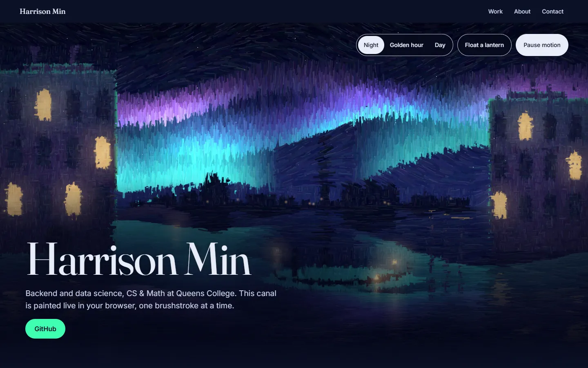

# Harrison Min · Portfolio

My portfolio for backend and data science internships. The hero is an oil painting of a
canal under the aurora, painted live in your browser one brushstroke at a time.

**Live site: [harrisonmin.vercel.app](https://harrisonmin.vercel.app)**



## Highlights

- **A live painted hero.** Brushstrokes are drawn onto a Canvas 2D from a scene
  model, in Night, Golden hour, or Day. Click the water, or press Float a
  lantern, to set a lantern drifting.
- **Reduced motion gets a still painting.** With `prefers-reduced-motion` or the
  Pause motion button, the painting is drawn off screen in small chunks and
  swapped in finished, so nothing moves. No pre-rendered image ships.
- **Text contrast is measured, not guessed.** A headless-browser script checks
  the text against every pixel of the painting behind it. Every line of hero text
  meets WCAG AA's 4.5:1 in all three modes at seven screen sizes; the measured
  values are in [ADR-007](docs/decisions/007-text-over-a-live-painting.md).
- **The Collection.** Aurora (in progress) hangs as a framed painting, drawn on
  the server as SVG. Woodshed and Pigment are pencil-sketch studies labeled
  Planned. Each has a Medium placard listing its draft stack.

## Stack

- Next.js 16 (App Router, Cache Components), React 19, TypeScript
- Tailwind CSS 4
- Canvas 2D for the hero; server-rendered SVG for the Collection artwork
- Fraunces and Inter via `next/font`
- ESLint, with CI on GitHub Actions
- Deployed on Vercel (free tier)

## Running it locally

Requires Node.js 20.9+ (22+ for `measure:hero`).

```bash
npm ci            # install exact versions from package-lock.json
npm run dev       # dev server at http://localhost:3000
npm run build     # production build
npm run lint
```

### Measuring the hero

`npm run measure:hero` opens the page in headless Chrome or Edge and measures
text contrast over the painting in each mode, focus-ring and button-edge
contrast, and layout at three desktop and four phone sizes. Run it after
changing the hero or anything drawn over it.

It talks to the browser directly, so it needs no extra npm packages; set
`BROWSER_PATH` if the browser isn't found. Measure a production build, so the
dev-tools badge isn't in the screenshots:

```bash
npm run build && npm run start   # terminal 1
npm run measure:hero             # terminal 2
```

It prints a summary that marks with `*` any value below the bars in ADR-007
(4.5:1 for text, 3:1 for focus rings and edges), and saves screenshots and a
JSON report to `hero-measurements/` (git-ignored). Optional flags (`--still`,
`--page`, `--rotation`, `--perf`, and `--readme-shot` to retake the screenshot
above) are documented at the top of
[`scripts/measure-hero.mjs`](scripts/measure-hero.mjs).

## How I work

- Every change starts as a GitHub issue on the
  [project board](https://github.com/users/hmin6/projects/3)
  (Backlog → Ready → In Progress → In Review → Done).
- One branch and one pull request per issue; the PR closes its issue.
- Commits follow [Conventional Commits](https://www.conventionalcommits.org)
  (`feat:`, `fix:`, `docs:`, `chore:`, `refactor:`).
- CI runs lint and build on every PR and on every push to main.
- A ruleset protects `main` from direct pushes.
- Each issue gets a devlog entry in [`docs/devlog/`](docs/devlog/).
- Major decisions are recorded in [`docs/decisions/`](docs/decisions/):
  - [ADR-001: Next.js over Astro](docs/decisions/001-nextjs-over-astro.md)
  - [ADR-002: Free hosting stack](docs/decisions/002-free-hosting-stack.md)
  - [ADR-003: Code-generated painting for the hero](docs/decisions/003-code-generated-painting.md)
  - [ADR-004: Canvas 2D first, WebGL later](docs/decisions/004-canvas-2d-first-webgl-later.md)
  - [ADR-005: Issue-driven workflow](docs/decisions/005-issue-driven-workflow.md)
  - [ADR-006: Imperative painter engine behind a thin React component](docs/decisions/006-imperative-painter-engine.md)
  - [ADR-007: Keeping text readable over a live painting](docs/decisions/007-text-over-a-live-painting.md)
  - [ADR-008: Still frames painted off screen, not a pre-rendered image](docs/decisions/008-still-frames-painted-off-screen.md)
  - [ADR-009: Site header above the painting, and Pause motion as a site-wide setting](docs/decisions/009-site-header-and-site-wide-motion.md)
  - [ADR-010: Collection artwork as SVG drawn on the server, and kind from status](docs/decisions/010-collection-artwork-and-project-kinds.md)
- I use Claude Code as a development tool. I plan each change in an issue,
  review every diff, and test it by hand. The ADRs and devlog record the
  decisions and what I learned.

## Project structure

```
src/app/                    pages, layout, global styles; site.ts and projects.ts hold the content
src/components/painter/     the hero's brushstroke renderer (engine, scene, strokes, stills, lanterns)
src/components/collection/  the Collection and its server-drawn SVG artwork
src/components/layout/      header, nav, footer, string dividers
src/components/about/       the About section
scripts/                    measure-hero.mjs, the headless-browser hero checks
docs/decisions/             architecture decision records (ADRs)
docs/devlog/                one entry per issue
reference/                  painted-canal.html, the original prototype
```
